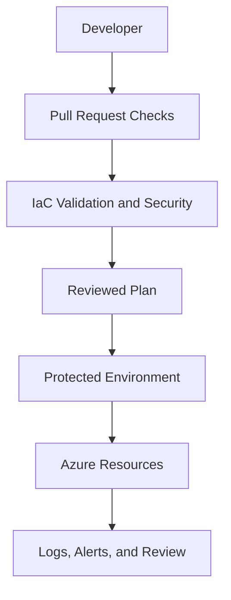

<div align="center">


[](https://developer.hashicorp.com/terraform)
[](https://azure.microsoft.com/)
[](https://github.com/haqueamir70-coder)

</div>

> **Portfolio project:** implementation status and limitations are documented below. The diagram describes the intended workflow/architecture and is not proof of a successful production deployment.

## 🗺️ Architecture at a Glance



---

# Azure Enterprise DevSecOps Platform

A portfolio project exploring enterprise-style Azure infrastructure organization with Terraform and security-conscious DevOps practices.

## Repository status

The current repository includes an `infrastructure/` directory. Review the files under that directory to confirm the resources, modules, and automation that are implemented. This README separates the project goals from verified implementation details.

## Objectives

- Structure Terraform code for maintainability and reuse.
- Define secure network and identity boundaries.
- Add consistent formatting, validation, linting, and infrastructure security scanning.
- Use reviewed plans and protected approvals for infrastructure changes.
- Document monitoring, operational considerations, and safe cleanup.

## Suggested workflow

```text
Pull request
   |
   v
Terraform fmt + validate
   |
   v
Lint + security scan
   |
   v
Plan and peer review
   |
   v
Protected approval
   |
   v
Apply to target environment
```

This is the intended workflow. Confirm the actual workflow files and CI results before representing these steps as active automation.

## Security baseline

- Use short-lived Azure authentication such as OIDC federation where supported.
- Apply least-privilege access to deployment identities.
- Protect Terraform state in a remote backend with locking and restricted access.
- Never commit credentials, state files, or sensitive plan artifacts.
- Pin and review third-party Actions and provider versions.
- Use environment approvals for production changes.
- Add Azure diagnostics, alerts, policy checks, and documented recovery procedures.

## Validation

Run Terraform commands from the relevant root module after reviewing its backend and provider configuration:

```bash
terraform fmt -check -recursive
terraform init -backend=false
terraform validate
```

These commands validate configuration syntax and formatting; they do not prove that the infrastructure is production-ready or that a deployment will succeed in a target subscription.

## Roadmap

- Document the architecture and each module.
- Add CI quality gates and security scanning.
- Document Azure authentication and remote state.
- Add test evidence, operational monitoring, and teardown guidance.

## Author

MD Amirul Haque · [GitHub profile](https://github.com/haqueamir70-coder) · [LinkedIn](https://www.linkedin.com/in/md-amirul-haque/)
