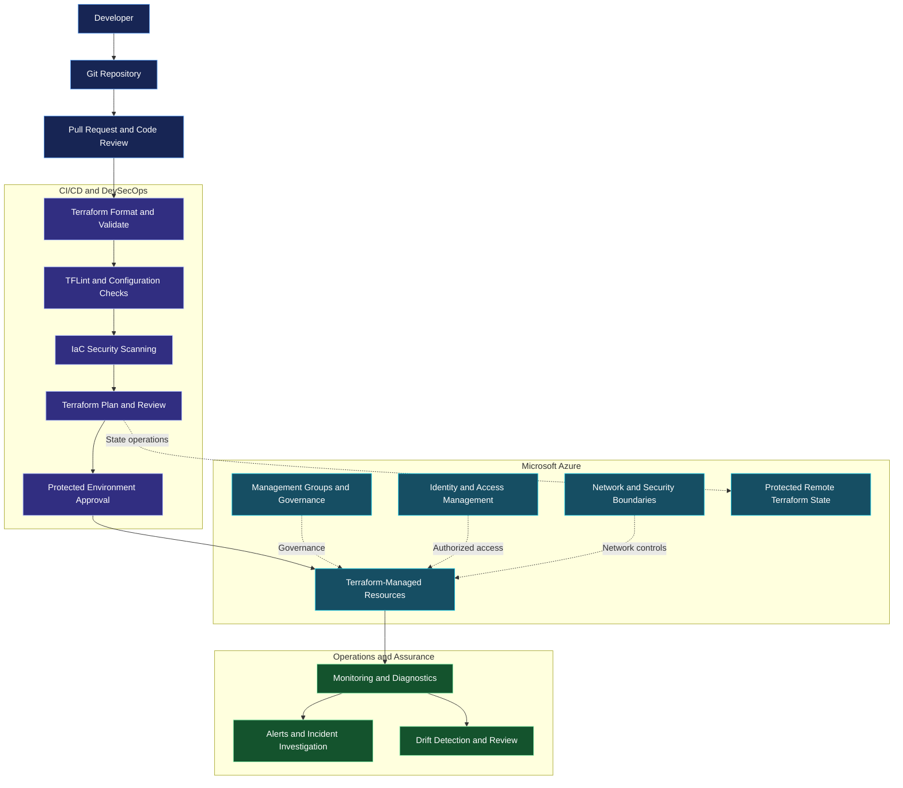

<div align="center">


<br/>

<a href="https://github.com/rajahalderops">
  
</a>
<a href="https://azure.microsoft.com/">
  
</a>
<a href="https://developer.hashicorp.com/terraform">
  
</a>
<a href="https://www.linkedin.com/in/raja-halder01/">
  
</a>

<br/><br/>

**CLOUD ENGINEERING • DEVSECOPS • DEVOPS • AUTOMATION • GOVERNANCE • SECURITY**

*Engineering secure, scalable, and maintainable cloud infrastructure.*

</div>

---

## 👨‍💻 Professional Overview

I am a Cloud and DevSecOps Engineer focused on infrastructure automation, cloud platform engineering, security integration, and reliable delivery practices.

This repository presents an enterprise-oriented approach to building and managing Azure infrastructure using Terraform and DevSecOps principles.

My engineering focus includes:

- **Infrastructure as Code:** Reusable Terraform modules, environment separation, and controlled infrastructure changes.
- **Cloud Platform Engineering:** Azure resource organization, networking, identity, and governance.
- **DevSecOps Automation:** Integrating infrastructure validation, linting, and security checks into CI/CD workflows.
- **Cloud Security:** Least-privilege access, secure authentication, policy enforcement, and secrets management.
- **Operational Reliability:** Infrastructure drift detection, monitoring, troubleshooting, and controlled recovery.

> **Engineering principle:** Security should be built into the infrastructure lifecycle—not added after deployment.

---

## 🏗️ Enterprise Architecture

The following diagram illustrates the intended architecture and delivery workflow for this project.



**Architecture note:** This diagram represents the target design. Verify the Terraform resources, pipeline configuration, Azure deployment, and operational integrations before describing them as implemented.

---

## ⚙️ Technology Stack

<div align="center">

### Cloud and Infrastructure


### Automation and Engineering


</div>

| Engineering Area | Technologies and Practices |
|---|---|
| Cloud Platform | Microsoft Azure |
| Infrastructure as Code | Terraform, reusable modules, remote state |
| CI/CD | Pipeline validation, plan review, controlled deployment |
| IaC Security | Checkov, tfsec, TFLint |
| Identity and Security | RBAC, least privilege, managed identities, OIDC |
| Cloud Networking | VNets, subnets, routing, private connectivity |
| Secrets Management | Azure Key Vault |
| Governance | Azure Policy, tagging, resource organization |
| Observability | Azure Monitor, Log Analytics, alerts |
| Version Control | Git and GitHub |

*The table describes the intended technology scope. Update it to reflect the tools and integrations actually implemented in the repository.*

---

## 🔐 Security-First Engineering

Security is a core design consideration throughout the proposed infrastructure lifecycle.

### 01. Identity and Access Management

- Apply least-privilege permissions to deployment identities.
- Separate human access from automation identities.
- Prefer workload identity federation or other supported short-lived authentication methods.
- Avoid hardcoded credentials and long-lived access keys.

### 02. Infrastructure Security

- Validate Terraform configurations before deployment.
- Scan infrastructure code for security misconfigurations.
- Review network exposure, identity permissions, and resource configurations.
- Use Azure Policy to enforce applicable governance requirements.

### 03. Secrets and State Protection

- Store application secrets in Azure Key Vault.
- Restrict access to Terraform state using appropriate Azure Storage permissions.
- Enable encryption and secure network access for remote state.
- Protect Terraform plan files, pipeline logs, and other potentially sensitive artifacts.

**Important:** Terraform's `sensitive = true` setting masks supported values in normal CLI output, but it does not automatically remove secrets from Terraform state.

### 04. Controlled Infrastructure Changes

- Review Terraform plans before applying changes.
- Require appropriate approval for production deployments.
- Separate development, test, and production environments.
- Detect configuration drift and investigate unexpected changes.
- Document recovery and rollback procedures.

---

## 🚀 DevSecOps Delivery Lifecycle

The intended workflow follows a controlled infrastructure delivery process.

| Stage | Activity | Expected Outcome |
|---|---|---|
| 01 | Source control | Version-controlled infrastructure |
| 02 | Pull request | Peer review and change visibility |
| 03 | Terraform validation | Configuration errors identified early |
| 04 | Linting and security scans | Potential misconfigurations identified |
| 05 | Terraform plan | Proposed infrastructure changes reviewed |
| 06 | Approval | Authorized deployment decision |
| 07 | Terraform apply | Approved infrastructure changes executed |
| 08 | Monitoring and drift review | Operational visibility and change detection |

### Example Validation Commands

Run these commands from the appropriate Terraform root module:

```bash
terraform fmt -check -recursive
terraform init -backend=false
terraform validate
```

For an initialized working directory with a configured backend, use an appropriate planning workflow:

```bash
terraform plan -out=tfplan
terraform show tfplan
```

Review the plan before applying it. Plan files can contain sensitive information and should be protected accordingly.

These commands demonstrate a validation approach; they do not establish that a complete CI/CD pipeline or Azure deployment is already operational.

---

## 📁 Repository Organization

A maintainable repository can separate infrastructure configuration, reusable modules, automation, and documentation.

```text
azure-enterprise-devsecops/
│
├── infrastructure/
│   ├── modules/
│   │   ├── networking/
│   │   ├── identity/
│   │   └── monitoring/
│   │
│   ├── environments/
│   │   ├── dev/
│   │   ├── test/
│   │   └── prod/
│   │
│   ├── providers.tf
│   ├── variables.tf
│   ├── outputs.tf
│   └── README.md
│
├── .github/
│   └── workflows/
│
├── docs/
│   ├── architecture.md
│   ├── security-baseline.md
│   └── operations.md
│
├── .gitignore
└── README.md
```

*This is a recommended repository layout, not a claim that every directory or file already exists. Adapt it to the actual repository structure.*

---

## 📊 Engineering Priorities

The project roadmap focuses on the following capabilities.

| Priority | Engineering Capability | Goal |
|---|---|---|
| P1 | Reusable Terraform modules | Improve consistency and maintainability |
| P2 | Automated validation | Detect configuration errors early |
| P3 | Infrastructure security scanning | Identify security risks before deployment |
| P4 | Secure remote state | Protect state data and control access |
| P5 | Environment protection | Reduce unauthorized infrastructure changes |
| P6 | Monitoring and drift detection | Improve operational visibility |
| P7 | Automated testing | Increase confidence in infrastructure changes |
| P8 | Governance and cost controls | Improve compliance and resource accountability |

---

## 🗺️ Project Roadmap

- [ ] Document the implemented Azure resources and Terraform modules.
- [ ] Add automated formatting, validation, and linting.
- [ ] Integrate infrastructure security scanning.
- [ ] Configure secure Azure authentication for automation.
- [ ] Document and validate remote Terraform state protection.
- [ ] Implement protected deployment environments.
- [ ] Add infrastructure testing and security validation evidence.
- [ ] Document monitoring, alerting, and drift detection.
- [ ] Publish deployment prerequisites and safe cleanup procedures.

As each capability is implemented and tested, update this checklist with the relevant evidence.

---

## 🧠 Engineering Philosophy

> **Automate the repeatable. Secure the critical. Validate the change. Monitor the outcome.**

I believe reliable cloud engineering requires more than creating resources. It requires thoughtful architecture, reusable automation, controlled changes, security awareness, and operational accountability.

This project is an opportunity to demonstrate those principles through infrastructure code, technical documentation, and verifiable implementation evidence.

---

## 🤝 Connect With Me

<div align="center">

### Raja Halder
**Cloud & DevSecOps Engineer**

Interested in cloud platform engineering, infrastructure automation, cloud security, and enterprise DevOps practices.

<br/>

<a href="https://github.com/rajahalderops">
  
</a>
<a href="https://www.linkedin.com/in/raja-halder01/">
  
</a>

<br/><br/>

*Building secure cloud foundations, one automation at a time.*

</div>
