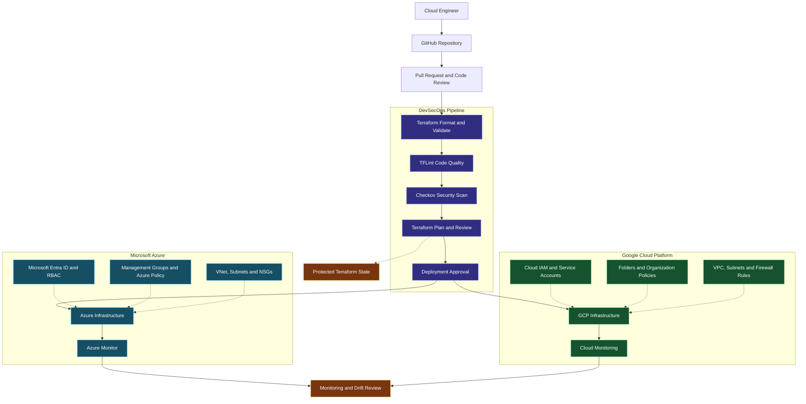

 <div align="center">


<br/>

<a href="https://github.com/rajahalderops">

</a>
<a href="https://azure.microsoft.com/">

</a>
<a href="https://cloud.google.com/">

</a>
<a href="https://developer.hashicorp.com/terraform">

</a>
<a href="https://www.linkedin.com/in/raja-halder01/">

</a>

<br/><br/>

**MULTI-CLOUD ENGINEERING • DEVSECOPS • AUTOMATION • GOVERNANCE • SECURITY**

*Building secure, scalable, and maintainable cloud infrastructure.*

</div>

---

## 👨‍💻 Professional Overview

The Multi-Cloud Enterprise DevSecOps Platform is a portfolio project focused on designing and managing infrastructure across Microsoft Azure and Google Cloud Platform (GCP).

It explores how Terraform, infrastructure security scanning, CI/CD automation, cloud-native governance, and operational monitoring can be combined into a consistent infrastructure delivery lifecycle.

### Core Objectives

- Design reusable Terraform modules for Azure and GCP.
- Organize infrastructure using environment-specific configurations.
- Integrate infrastructure validation and security scanning into CI/CD.
- Apply least-privilege identity and access controls.
- Protect Terraform state and deployment credentials.
- Establish cloud governance, monitoring, and drift-detection practices.
- Document repeatable deployments and safe infrastructure changes.

> **Project transparency:** The architecture below describes the intended solution. Resources, pipelines, and security controls should be marked as implemented only after successful testing.

---

## 🏗️ Multi-Cloud Enterprise Architecture



The diagram shows the target workflow. The two cloud environments retain independent identity systems, networking, governance, and deployment permissions.

---

## ☁️ Microsoft Azure Engineering

Azure infrastructure can be organized using a landing-zone approach, with clear separation between governance, networking, identity, and workloads.

| Engineering Area | Azure Services |
|---|---|
| Resource organization | Management Groups, Subscriptions, Resource Groups |
| Identity and access | Microsoft Entra ID, Azure RBAC |
| Governance | Azure Policy, resource tagging |
| Networking | VNets, Subnets, NSGs, Route Tables |
| Connectivity | Azure Firewall, VPN Gateway, Private Endpoints |
| Secrets | Azure Key Vault |
| Infrastructure as Code | Terraform AzureRM Provider |
| Monitoring | Azure Monitor, Log Analytics |
| Security posture | Microsoft Defender for Cloud |

### Azure Engineering Priorities

- Implement consistent subscription and resource organization.
- Enforce mandatory resource tags and governance policies.
- Use managed identities or supported federated authentication.
- Secure remote Terraform state.
- Restrict public network access where appropriate.
- Monitor infrastructure changes and security findings.

Official documentation: [Azure Terraform Provider](https://registry.terraform.io/providers/hashicorp/azurerm/latest/docs)

---

## ☁️ Google Cloud Platform Engineering

GCP infrastructure can follow an organization-based hierarchy, with governed folders and projects.

| Engineering Area | GCP Services |
|---|---|
| Resource organization | Organization, Folders, Projects |
| Identity and access | Cloud IAM, Service Accounts |
| Governance | Organization Policy Service |
| Networking | VPC Networks, Subnets, Firewall Rules |
| Connectivity | Cloud VPN, Cloud NAT, Private Google Access |
| Secrets | Secret Manager |
| Infrastructure as Code | Terraform Google Provider |
| Monitoring | Cloud Monitoring, Cloud Logging |
| Security posture | Security Command Center |

### GCP Engineering Priorities

- Establish an appropriate organization and project hierarchy.
- Apply least-privilege IAM permissions.
- Restrict prohibited configurations with organization policies.
- Design controlled network access and egress.
- Use service accounts with appropriately scoped permissions.
- Monitor audit logs, infrastructure health, and security findings.

Official documentation: [Google Terraform Provider](https://registry.terraform.io/providers/hashicorp/google/latest/docs)

---

## 🧱 Terraform Multi-Cloud Strategy

Terraform provides a shared infrastructure-as-code workflow while provider-specific resources and modules manage each cloud.

### Recommended Repository Structure

```text
multi-cloud-devsecops/
|
|-- modules/
|   |-- azure/
|   |   |-- networking/
|   |   |-- identity/
|   |   |-- key-vault/
|   |   `-- monitoring/
|   |
|   `-- gcp/
|       |-- networking/
|       |-- iam/
|       |-- project-baseline/
|       `-- monitoring/
|
|-- environments/
|   |-- azure/
|   |   |-- dev/
|   |   |-- test/
|   |   `-- prod/
|   |
|   `-- gcp/
|       |-- dev/
|       |-- test/
|       `-- prod/
|
|-- policies/
|-- scripts/
|-- docs/
|-- .github/
|   `-- workflows/
|
|-- .gitignore
`-- README.md
```

This is a proposed layout. Create and populate these directories as the implementation grows.

### Example Terraform Provider Configuration

The following is an illustrative configuration for a root module that needs both providers.

```hcl
terraform {
  required_version = ">= 1.6.0"

  required_providers {
    azurerm = {
      source  = "hashicorp/azurerm"
      version = "~> 4.0"
    }

    google = {
      source  = "hashicorp/google"
      version = "~> 7.0"
    }
  }
}

provider "azurerm" {
  features {}
}

provider "google" {
  project = var.gcp_project_id
  region  = var.gcp_region
}
```

Create `variables.tf`:

```hcl
variable "gcp_project_id" {
  description = "Google Cloud project ID"
  type        = string
}

variable "gcp_region" {
  description = "Default Google Cloud region"
  type        = string
}
```

Before execution, verify compatible provider versions, configure Azure subscription authentication, authenticate to GCP, and ensure both identities have the necessary permissions.

For production, prefer separate root modules and state boundaries for Azure and GCP where practical. This reduces coupling and limits the blast radius of changes.

---

## 🔐 DevSecOps Security Baseline

Security controls should be integrated throughout the infrastructure lifecycle.

### Identity and Access Management

- Apply least-privilege access.
- Separate deployment identities from human accounts.
- Use managed identities or workload identity federation where supported.
- Avoid hardcoded credentials and long-lived service-account keys.

### Infrastructure Security

- Validate Terraform configuration before deployment.
- Scan infrastructure code using Checkov or an equivalent scanner.
- Review network exposure, IAM permissions, and resource configurations.
- Apply Azure Policy and GCP Organization Policy where appropriate.

### Secrets and State Protection

- Use Azure Key Vault for Azure workloads.
- Use Google Secret Manager for GCP workloads.
- Protect Terraform state with restricted access and encryption.
- Secure plan files, pipeline artifacts, and logs.
- Remember that Terraform's `sensitive = true` masks supported output but does not automatically remove secret values from state.

### Deployment Protection

- Review Terraform plans before applying changes.
- Require appropriate approvals for production.
- Separate development, test, and production environments.
- Monitor configuration drift.
- Document recovery and cleanup procedures.

---

## 🚀 CI/CD Delivery Lifecycle

The intended delivery lifecycle is:

```text
Developer Commit
       |
       v
Pull Request and Code Review
       |
       v
Terraform Format and Validate
       |
       v
Linting and Security Scanning
       |
       v
Provider-Specific Terraform Plan
       |
       v
Peer Review and Approval
       |
       v
Deploy to Azure or GCP
       |
       v
Monitoring and Drift Review
```

### Validation Commands

Run these commands from the appropriate Terraform root module:

```bash
terraform fmt -check -recursive
terraform init -backend=false
terraform validate
```

For a configured working directory with an initialized backend:

```bash
terraform plan -out=tfplan
terraform show tfplan
```

Review the plan before applying it. Protect saved plan files because they may contain sensitive information.

These commands validate Terraform configuration and illustrate planning; they do not prove that a working multi-cloud pipeline has been deployed.

---

## 🛠️ Technology Stack

| Category | Technologies |
|---|---|
| Cloud platforms | Microsoft Azure, Google Cloud Platform |
| Infrastructure as Code | Terraform |
| CI/CD | GitHub Actions or Azure DevOps |
| IaC security | Checkov, tfsec |
| Code quality | TFLint |
| Azure identity | Microsoft Entra ID, Azure RBAC |
| GCP identity | Cloud IAM, Service Accounts |
| Secrets management | Azure Key Vault, Google Secret Manager |
| Governance | Azure Policy, GCP Organization Policy |
| Monitoring | Azure Monitor, Cloud Monitoring |
| Version control | Git, GitHub |

This is the intended technology scope; adjust it to match the tools actually configured and tested.

---

## 📊 Project Roadmap

- [ ] Build and document an Azure landing-zone baseline.
- [ ] Build and document a GCP project and networking baseline.
- [ ] Create reusable Terraform modules for both clouds.
- [ ] Configure protected remote state and separate state boundaries.
- [ ] Integrate Terraform validation and linting into CI/CD.
- [ ] Add infrastructure security scanning.
- [ ] Configure secure deployment authentication.
- [ ] Add protected deployment environments and approvals.
- [ ] Implement monitoring and drift detection.
- [ ] Publish deployment instructions and implementation evidence.

---

## 🧠 Engineering Philosophy

> **One engineering workflow. Cloud-native security. Independent governance. Repeatable infrastructure.**

The goal is to demonstrate how cloud infrastructure can be managed consistently across Azure and GCP without sacrificing the provider-specific security, identity, and governance controls each environment requires.

---

## 🤝 Connect With Me

**Raja Halder | Cloud & DevSecOps Engineer**

- 🐙 GitHub: [Explore My Projects](https://github.com/rajahalderops)
- 💼 LinkedIn: [Connect With Me](https://www.linkedin.com/in/raja-halder01/)

*Multi-cloud engineering • Terraform • Azure • Google Cloud*


*Building secure, automated, and maintainable multi-cloud foundations.*

</div>
